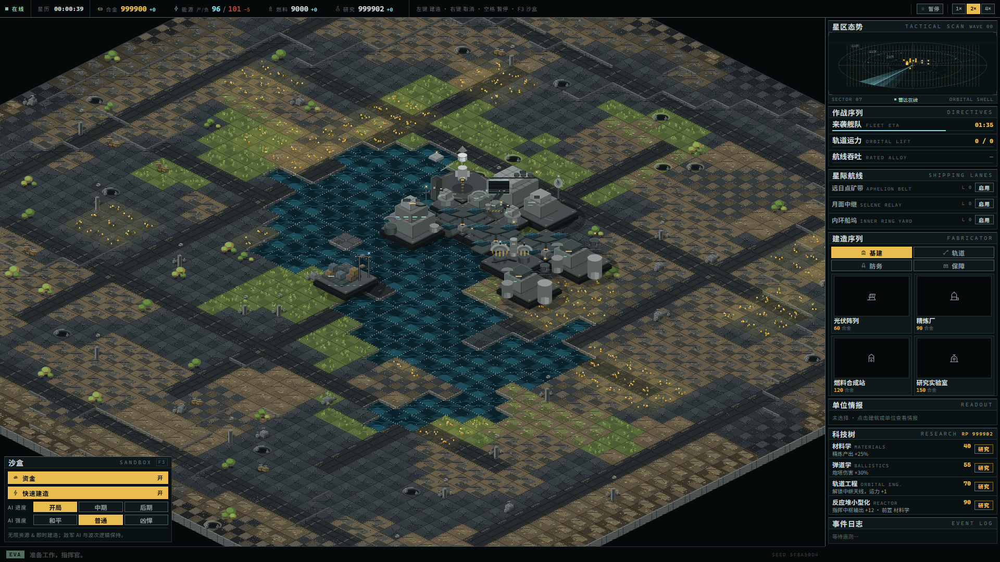
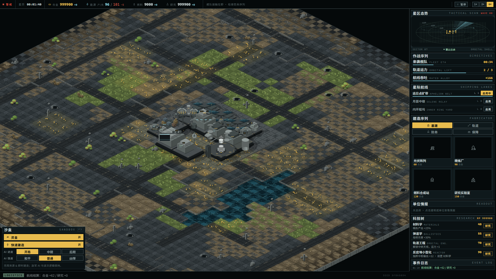

# APHELION · 远日点指挥终端 `0.1.0a0`

[](https://github.com/AIWuXin/APHELION/actions/workflows/ci.yml)

> **APHELION** —— 轨道上离恒星最远的那一点。把它当作一座被遗弃在矿脉行星上的指挥终端：
> 资源、运力、补给他们都在最远端，你只有自己的判断。

等距视角的星球建造 + 太空计划 + 星际物流与舰队对抗。**Rust 仿真内核 + TypeScript 表现层**，
在浏览器里单机运行；同时提供单文件 Windows 启动器（`dist-exe/APHELION-0.1.0a0.exe`）。

```
建造殖民地 → 通电与采掘 → 造火箭送上轨道 → 开通星际航线 → 抵御周期来袭的舰队 → 再投资
```



<p align="center"><sub>建造 → 发射 → 航线 → 防御：同一局的战斗状态与调试层</sub></p>



- **确定性内核**：同 seed + 同命令序列 → 同状态哈希（CI 双跑比对，3000 tick）
- **二进制协议**：postcard 经线性内存传输，零 JSON；类型由 `ts-rs` 从 Rust 生成，跨语言固件测试兜底
- **零运行时依赖**：前端无框架、无位图、无 emoji、无图标字体；世界 Canvas，HUD 是 DOM
- **一条命令出 exe**：`pnpm run package` → 0.42 MiB 单文件，内嵌全部前端资源

---

## 快速开始

**方式 A：直接双击 `exe`（推荐给只想玩的人）**

```text
dist-exe\APHELION-0.1.0a0.exe
```

单文件、0.42 MiB，前端资源（HTML / JS / CSS / wasm）全部内嵌在二进制里。双击后它会在
`127.0.0.1` 上选一个空闲端口启动本地服务，并用系统默认浏览器打开游戏；关闭控制台窗口即退出。
**不需要** Node.js、不需要 WebView2、不需要安装程序。

命令行选项：`--port 8137` 指定端口 · `--no-open` 只起服务不开浏览器 · `--help`。

重新打包：

```bash
pnpm install
pnpm run package        # wasm → vite build → cargo build --release → dist-exe/
```

**方式 B：从源码跑开发服务器**

```bash
pnpm install
pnpm run wasm        # cargo build --target wasm32-unknown-unknown → web/public/oc.wasm
pnpm run dev         # http://127.0.0.1:5178
```

需要：Node 20+、pnpm、Rust 1.80+ 且已安装 `wasm32-unknown-unknown`
（`rustup target add wasm32-unknown-unknown`）。**不需要** wasm-pack / wasm-bindgen。

生产构建与自检：

```bash
pnpm run build                  # wasm + tsc --noEmit + vite build → dist/
node scripts/ci.mjs             # 全套 CI：fmt / clippy -D warnings / test / 确定性 / wasm / tsc / eslint / vitest / build / 守卫脚本 / exe 打包
node scripts/ci.mjs --web       # 只跑前端
node scripts/screenshot.mjs     # 无头截图到 .tmp/shot.png（并报告 console 报错）
```

URL 参数：

| 参数 | 作用 |
|---|---|
| `?debug=1` | 调试层：fps / step 耗时 / tick / 哈希 / 实体数 / 快照字节 |
| `?seed=123456` | 固定世界（同 seed + 同命令序列 → 同状态哈希） |
| `?demo=1` | **演示模式**：自动走完开局（建 14 座建筑、发射两次、开通两条航线、研究材料学），全部通过正常 Command 通道 |
| `?rush=1` | 配合 `?demo=1`，保持 4× 速度跑，便于在 1 分钟内看到第一波敌舰 |

截图取证（每个阶段都必须可运行、可截图）：

```bash
node scripts/build-wasm.mjs && npx vite build
node scripts/screenshot.mjs --demo --out .tmp/shot.png          # 1920×1080
node scripts/screenshot.mjs --demo --rush --out .tmp/combat.png # 战斗状态
node scripts/screenshot.mjs --width 1280 --height 720 --demo     # 窄屏不破版
```

`scripts/screenshot.mjs` 用本机已安装的 Chrome（playwright-core `channel: 'chrome'`）+ 进程内静态服务器，
并把所有 console / pageerror 报错打印出来；有报错即非零退出。

---

## 操作

| 输入 | 行为 |
|---|---|
| 左键 | 选中建筑 / 单位；处于建造模式时放置 |
| 右键 / `Esc` | 取消建造模式或取消选中 |
| 拖拽 / `WASD` / 方向键 | 平移镜头（边界按投影菱形钳制，四角都能拖到） |
| 滚轮 / `+` `-` | 缩放 0.75×–2.5×（纯正交放大，不改变投影；默认 100%） |
| `0` | 回到殖民地总览（缩放复位到 100%） |
| 空格 | 暂停 / 继续 |
| `1` `2` `3` | 1× / 2× / 4× 仿真速度 |
| `T` | 切换下一条星际航线 |
| `F3` | 显示 / 隐藏左下 SANDBOX 面板 |
| 右栏 | 建造卡点击进入放置模式；页签切换 基建 / 轨道 / 防务 / 保障；单位情报面板可发射与拆除 |

---

## 架构一页

```
Rust  (全部规则与仿真)                      TypeScript (全部表现)
crates/iso      纯数学/定点/RNG              web/src/render  Canvas 世界层
crates/content  数据表                       web/src/ui      DOM HUD
crates/protocol Command / Snapshot / 版本     web/src/net     Transport + 二进制编解码
crates/sim      5 个系统，确定性，无 I/O       web/src/app     单向数据流编排
crates/bridge-wasm  12 个 extern "C" 函数     web/src/generated  ts-rs + codegen 产物（禁止手写）
crates/launcher  单文件 exe：内嵌 dist + 本地 HTTP + 开浏览器  ← 纯 std，零依赖
```

> 版本：Cargo/npm 用 semver `0.1.0-a0`，展示与产物文件名为 `0.1.0a0`
> （`oc_protocol::PRODUCT_VERSION`，同时出现在启动器横幅与 `?debug=1` 的调试层里）。

**单向数据流**：`输入 → Command[] → Transport.send → sim.step() → Snapshot → 渲染 / HUD`。
渲染与 HUD 只读快照，不持有任何规则；放置合法性由仿真的 `oc_query_place` 回答。

**确定性**：整数/定点状态、固定步长 30Hz、多流域 RNG、无时钟无 I/O；
同 seed + 同命令序列 → 同状态哈希（`cargo run -p oc-sim-cli -- 3000` 连跑两次比对，CI 强制）。

**协议**：postcard 二进制，经线性内存零 JSON 传输；TS 类型由 `ts-rs` 从 Rust 结构生成；
Rust 产出的 `snapshot.bin / commands.bin / boot.bin` 金标准固件被 `vitest` 逐字段/逐字节校验。

细节：
[`docs/design.md`](docs/design.md)（风格 token 表 / 架构图 / 风险与验证）、
[`docs/architecture.md`](docs/architecture.md)（10 分钟上手：怎么加建筑、怎么换 Transport）、
[`docs/decisions.md`](docs/decisions.md)（每条偏离与冲突裁决）。

---

## 加一个建筑（两处，编译器强制）

1. `crates/content/src/buildings.rs` — 末尾追加一行 `BuildingRow`，`B_COUNT` 加一。
2. `web/src/render/sprites/buildings.ts` — 在 `BUILDING_PAINTERS` 里加一个绘制函数。

`cargo test -p oc-content` 重新生成 `web/src/generated/content-keys.ts`，
`BuildingKey` 联合类型立刻包含新键；`Record<BuildingKey, BuildingPainter>` 缺项即 **tsc 报错**。
不需要改任何系统逻辑。

## 换 Transport（接服务端）

实现 `web/src/net/transport.ts` 的 `Transport`，然后把 `app/app.ts` 里
`new WasmTransport()` 换成你的实现即可——渲染层与 HUD 完全不知道数据来自哪里。
二进制帧契约已就绪（`encodeCommandBatch` / `decodeSnapshot`），禁止每 tick JSON。

---

## 验收自检：8 条视觉不变量

| # | 不变量 | 落地位置 | 自检 |
|---|---|---|---|
| 1 | 2:1 等距正交、固定机位、体积物由基本体拼成 | `render/iso.ts` 固定 64×32；`render/primitives.ts` 只提供 box / cylinder / dome / prism | ✅ 无透视、无缩放、无旋转；所有资产由四种基本体组合 |
| 2 | 统一左上光；三面 1.0/0.86/0.68 + 1px 亮棱暗棱；短柔阴影偏右下 | `tokens.ts LIGHT`；`primitives.ts` 的 `box/cylinder/dome/prism/contactShadow` | ✅ 单一只 `LIGHT` 常量，无第二套明暗；阴影恒偏右下（左右归属的裁决见 decisions C-01） |
| 3 | 硬边拼花表面：底色 + 低频噪声 + 细 dither + 1px 暗缝；材质硬边相接 | `render/terrain-layer.ts` 各材质 painter | ✅ 8 种材质各自的纹理语言；边界仅用 5 点 dither，无大面积渐变 |
| 4 | HUD 哑光近黑钢板 + 1px 冷钢描边 + 直角；禁玻璃/模糊/泛光/大圆角 | `ui/hud.css` | ✅ 无 `backdrop-filter`、无 `filter: blur`、无 `box-shadow` 光晕；`border-radius: 0` |
| 5 | 压深黑位 + 低饱和；只有主强调/功能/状态三色，危险色仅警报与敌方 | `tokens.ts PALETTE` 唯一色源 | ✅ 全部强调色从 PALETTE 取；`--oc-danger` 只出现在警报与敌方资产 |
| 6 | 中文为主体（700），英文宽字距小号；数字等宽；三档字号；1px 分隔线 | `ui/hud.css` + `ui/*.ts` | ✅ 10/12/14 + 26 显示位；`.oc-num` 系列 `tabular-nums`；分隔线全为 1px |
| 7 | 全部程序化绘制或内联 SVG 线性图标；零位图/emoji/图标字体 | `ui/icons.ts` + `render/**` | ✅ `scripts/check-assets.mjs` 在 CI 里强制 |
| 8 | 世界用 Canvas、HUD 用 DOM；两者共用同一套色板 token | `render/*` vs `ui/*`；`style/tokens.ts` + `inject-theme.ts` | ✅ HUD 只读 `--oc-*` 变量（由 tokens 注入），Canvas 直接 import PALETTE |

## 工程验收

| 项 | 状态 |
|---|---|
| 依赖方向零违规 | ✅ ESLint `no-restricted-imports` 强制；`render/` `ui/` 不得 import `app/` `net/` |
| 协议类型全部生成 | ✅ `ts-rs` → `web/src/generated/*.ts`；内容 key 由 `oc-content` codegen |
| 新增建筑只改两处 | ✅ content 表 + 渲染注册，缺一即编译错误 |
| clippy / tsc 零警告 | ✅ `cargo clippy --all-targets -- -D warnings`、`tsc --noEmit` |
| 同 seed 状态哈希一致 | ✅ `oc-sim-cli` 双跑比对 + `crates/sim/tests/determinism.rs` |
| 60fps / 30Hz | ✅ 地形一次性烘焙、精灵不逐帧重建、HUD 脏检查；`?debug=1` 可观测 |
| 无位图请求 | ✅ 仅 `oc.wasm` 一个二进制请求 |
| 中文无乱码 | ✅ UTF-8 + 系统黑体栈 |
| 1280 / 1920 不破版 | ✅ 右栏 300/336px 两档，建造卡恒 2 列 |
| 单文件 ≤ 400 行 | ✅ `scripts/check-file-length.mjs` 在 CI 里强制 |

---

## 自评（每阶段三条：守住的不变量 / 偏离的默认值 / 本阶段创意点）

**P0 脚手架 + 协议 + CI**
- 守住：不变量 8（Canvas/DOM 分工与共享 token 从第一天就定型）、不变量 7（无位图，wasm 是唯一二进制）。
- 偏离：N-02（字体用系统栈，不打包思源黑体）——理由见 decisions。
- 创意点：**内容 key 由 Rust codegen 成 TS 联合类型**，让「只改两处」与「编译期完备」同时成立。

**P1 仿真五系统 + 确定性**
- 守住：确定性（整数状态、固定步长、多流域 RNG）、协议一律二进制、新增字段自动进入哈希。
- 偏离：N-01（地图改为 44×44 且可平移）——44×44 才能容纳「建造→发射→防御」纵深。
- 创意点：**哈希即编码**（对 hash=0 的整帧编码后做 FNV），新增字段无需维护哈希清单。

**P2 表现层（Canvas + DOM HUD）**
- 守住：不变量 1/2/3/4/5/6/7/8 逐条对照实现（见上表）；HUD 无模糊、无泛光、直角、1px。
- 偏离：N-03（顶栏 34px / 右栏 336px，均在 20% 内）、N-04（选中用琥珀实底而非发光）。
- 创意点：**等高线崖壁**（由 elevation step 生成 3–4px 岩面）、雷达地表轮廓取自真实材质场、
  矿脉琥珀点作为唯一资源标记。

**P3 交互闭环 + 性能**
- 守住：单向数据流（放置合法性由仿真回答，TS 不复制规则）、60fps 渲染 / 30Hz 仿真、
  `?debug=1` 可观测。
- 偏离：D-06（新增「星际航线」与「事件日志」两个 HUD 模块）——默认组成没有航线的操作面。
- 创意点：**轨道航线的地面走线**（青色行进虚线只在航线开启时出现）、发射台火箭高度等于
  `progress`、施工骨架随进度长高。

---

## 已知限制

- 单机 demo：`crates/server` 与 `WebSocketTransport` 只预留了契约（P4 可选，未实现）。
- AI 只有「跃迁波次导演」，没有真正的对手建造 AI；难度由波次编制与间隔表达。
- 科技树 4 项、建筑 14 种、单位 7 种：够走完闭环，不是完整商业体量。
- 跨平台字形宽度差异（N-02）：中文字距在 Windows/macOS 上略有不同，已用 px 字号与字距约束住。

---

## 许可证

MIT，见 [`LICENSE`](LICENSE)。欢迎 issue / PR；架构与取舍先读
[`docs/design.md`](docs/design.md) 与 [`docs/decisions.md`](docs/decisions.md)，改内容只读
[`docs/architecture.md`](docs/architecture.md) 的「怎么加一个建筑 / 怎么换 Transport」。